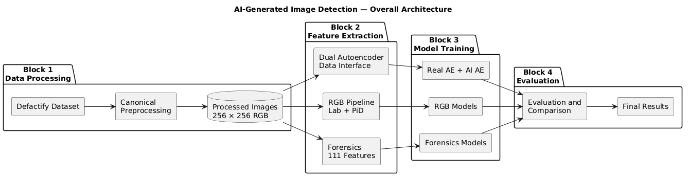
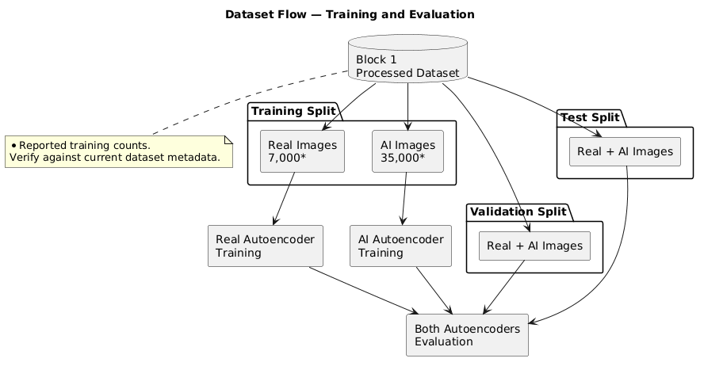
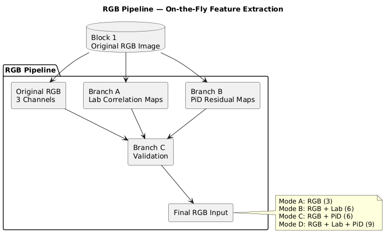
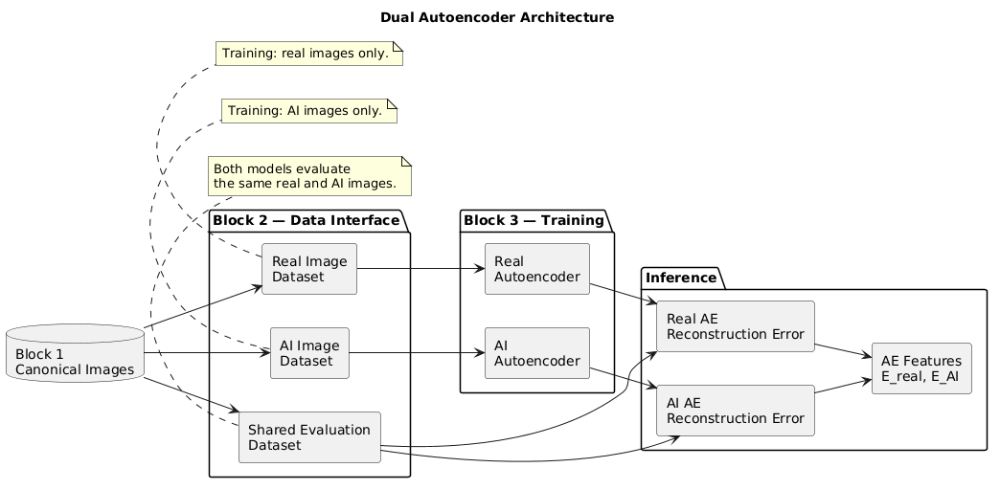
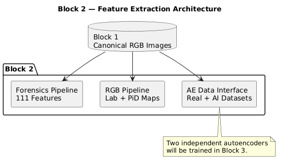

# AI Image Detection --- Semester 5 Minor Project

A modular research project for detecting AI-generated images using a
**data-efficient, low-complexity combination of RGB and low-level
forensic evidence**.

The project is deliberately organized into four sequential blocks. Each
block consumes a defined output from the previous block and stores its
own output so that later development and experiments do not require
repeatedly rerunning earlier stages.

> **Current project status (2026-11-26):** Block 1 and the Forensics
> pipeline are reported complete. The RGB pipeline is implemented with
> on-the-fly Lab and PiD representation extraction; normal training does
> not require a separately materialized RGB dataset. The Block 2 AE data
> interface for two class-specific autoencoders is planned but has not
> yet been verified as implemented. Block 3 model development/training
> and Block 4 evaluation remain separate downstream stages.

------------------------------------------------------------------------

## 1. Research Objective

The central research question is:

> **Can carefully selected low-level forensic evidence provide useful
> AI-image detection while minimizing training image count, feature
> count, model complexity, and inference cost, while remaining useful on
> unseen generators and compressed images?**

The project is not primarily attempting to build the largest or most
accurate detector possible. Its focus is the **performance--efficiency
trade-off**:

-   How much training data is actually needed?
-   How many features are actually useful?
-   How much redundant information exists across forensic
    representations?
-   How much model complexity is necessary?
-   How well do the resulting representations generalize to generators
    not used for training?
-   How does controlled JPEG compression affect the evidence?

The project therefore treats feature extraction, feature analysis, and
feature selection as central research components rather than merely
preprocessing.

------------------------------------------------------------------------

# 2. Four-Block Architecture

The project is organized into four sequential blocks. Each block has a
defined responsibility and exposes outputs or interfaces for the next
stage.



### Block responsibilities

1.  **Block 1 --- Data loading and preprocessing:** converts the raw
    Defactify images into the canonical 256 × 256 RGB representation.
2.  **Block 2 --- Feature and representation pipelines:** provides three
    independent pathways: Forensics, RGB, and the planned dual-AE data
    interface.
3.  **Block 3 --- Model development and training:** trains the forensic
    and RGB models, and will implement and train the two class-specific
    autoencoders.
4.  **Block 4 --- Evaluation and experiments:** compares the approaches
    under controlled data, feature, generator-generalization,
    compression, and efficiency conditions.



See the detailed architecture and implementation documents under
`docs/`.

# 3. Dataset

## Primary dataset

**Defactify**

The project architecture document specifies:

-   96,000 images
-   16,000 real images
-   80,000 AI-generated images
-   five AI generators:
    -   Stable Diffusion 2.1
    -   Stable Diffusion XL
    -   Stable Diffusion 3
    -   DALL-E 3
    -   Midjourney v6

`Label_A` is the binary real/fake target.

`Label_B` is evaluation metadata and is **not detector input**.

The raw dataset is treated as immutable project input and is not
intended to be committed to Git.

See [`docs/BLOCK_1_DATA_PIPELINE.md`](docs/BLOCK_1_DATA_PIPELINE.md).

------------------------------------------------------------------------

# 4. Block 1 --- Data Loading and Preprocessing

Block 1 converts the raw dataset into the canonical image representation
used by downstream analysis.

``` text
Raw image
   ↓
largest centered square crop
   ↓
resize to 256 × 256
   ↓
RGB uint8
   ↓
stored processed data
```

Canonical rules:

-   deterministic centered crop
-   crop before resize
-   `cv2.INTER_AREA`
-   no padding/letterboxing
-   no random crop
-   no random augmentation
-   no aspect-ratio squashing
-   no common ImageNet normalization for forensic extraction

The detector must not use:

-   caption
-   path
-   filename
-   generator identity
-   split
-   EXIF
-   JPEG container metadata
-   original JPEG quantization tables
-   file size
-   source IDs

See [`docs/BLOCK_1_DATA_PIPELINE.md`](docs/BLOCK_1_DATA_PIPELINE.md).

------------------------------------------------------------------------

# 5. Block 2 --- Dual Image-Analysis Pipeline

Block 2 is the main feature/representation engineering stage.

It has two deliberately different paths.

## 5.1 Forensic pipeline

The forensic pipeline is designed around multiple low-level evidence
domains:

  ----------------------------------------------------------------------
  Branch               Evidence domain                Canonical features
  -------------------- --------------------- ---------------------------
  A                    Frequency /                                    34
                       periodicity (A1       
                       FFT=4, A2             
                       Synthbuster=30)       

  B                    Haar wavelet (3-level                          30
                       2D DWT subbands)      

  C                    Local texture                                  16
                       (rotation-invariant   
                       uniform LBP)          

  D                    Residual / noise (3×3                           5
                       median filter         
                       residual)             

  E                    JPEG /                                         26
                       compression-aware (E1 
                       DCT=10, E2            
                       Response=8, E3        
                       Phase=4, E4 Grid=4)   

  **Total**            **Canonical forensic                      **111**
                       pool**                
  ----------------------------------------------------------------------

The **111-feature pool is fully implemented and verified**. All 111
features are materialized in the persistent dataset
`data/forensic_dataset/features.parquet` across all 42,000 training
images.

Branch C and Branch D contain alternative candidate pipelines reserved
for ablation studies:

-   C_LBP: 16 (canonical)
-   C_GLCM: 24 (alternative)
-   C_LBP_EDGE: 16 (alternative)
-   D_HIGHPASS: 5 (alternative)
-   D_LAPLACIAN: 5 (alternative)
-   D_MFR: 5 (canonical)

These alternatives are evaluated independently and not concatenated into
the canonical 111-feature dataset.

See:

-   [`docs/FORENSIC_PIPELINE.md`](docs/FORENSIC_PIPELINE.md)
-   [`docs/BRANCH_A_FREQUENCY.md`](docs/BRANCH_A_FREQUENCY.md)
-   [`docs/BRANCH_B_WAVELET.md`](docs/BRANCH_B_WAVELET.md)
-   [`docs/BRANCH_C_TEXTURE.md`](docs/BRANCH_C_TEXTURE.md)
-   [`docs/BRANCH_D_RESIDUAL.md`](docs/BRANCH_D_RESIDUAL.md)
-   [`docs/BRANCH_E_JPEG.md`](docs/BRANCH_E_JPEG.md)

## 5.2 RGB pipeline

The RGB pathway retains spatial image information and remains
independent of the handcrafted forensic feature pipeline.



The active RGB pipeline has three branches:

-   **Branch A --- Lab local-correlation maps:** converts RGB to CIE Lab
    and calculates the three local Pearson correlation maps (L-a, L-b,
    and a-b) using the established 7 × 7 neighbourhood.
-   **Branch B --- PiD residual maps:** uses the selected BT.601
    full-range YCbCr transformation and scaling parameter `s=0.2` to
    produce signed RGB-channel residual maps.
-   **Branch C --- validation:** validates the generated
    representations; it does not generate an additional feature
    representation.

NQP research code and screening results are retained for reproducibility
but are excluded from the active RGB execution path.

### On-the-fly data flow

The RGB dataset reads the original canonical images directly from
Block 1. Branch A and Branch B are calculated on demand according to the
selected experiment mode.

  Mode     Input channels Composition
  ------ ---------------- ---------------------------------------------
  A                     3 Original RGB
  B                     6 Original RGB + Lab maps
  C                     6 Original RGB + PiD residual maps
  D                     9 Original RGB + Lab maps + PiD residual maps

No separate `rgb_dataset/` or `rgb_cache/` is required or created by the
normal training path. The optional materializer is not part of normal
training and must not be invoked automatically.

The selected representations are implementation decisions for downstream
experiments; they are not claims of proven detection-accuracy
superiority. The reported implementation includes the PiD reconstruction
clipping and typing/documentation corrections.

See [`docs/RGB_PIPELINE.md`](docs/RGB_PIPELINE.md).

## 5.3 Dual-autoencoder pathway (planned)

The project is extending Block 2 with an independent autoencoder data
interface. It will provide access to the original Block 1 images for two
separate class-specific convolutional autoencoders.



-   **Real AE:** will be trained only on real training images
    (`label_a == 0`).
-   **AI AE:** will be trained only on AI-generated training images
    (`label_a == 1`).
-   **Shared evaluation:** both trained models will be evaluated on the
    same real and AI validation/test images so their reconstruction
    errors can be compared on identical inputs.

The Block 2 scope is limited to datasets and DataLoader interfaces,
including class filtering, split handling, and sample-identity
preservation. The AE architectures, training loops, losses, optimizers,
checkpoints, inference, and reconstruction-error feature extraction
belong to Block 3.

The AE pathway must read the canonical Block 1 images directly. It must
not create another image dataset or duplicate the original images.

The AE implementation is **planned and not yet verified as implemented**
in this README revision. See the project status section before relying
on this interface.

# 6. Why the Forensic Branches Are Separate

The five forensic branches are **designed to interrogate different types
of low-level evidence**, but the project does not assume that they are
statistically independent.

This distinction is important.

For example:

-   FFT and DCT are both frequency-domain representations.
-   Haar high-frequency bands and LBP can both respond to local detail.
-   LBP and residual statistics can respond to related
    local/high-frequency structure.
-   DCT/compression response and residual behavior can be correlated.

Therefore:

> **Complementarity is a research hypothesis, not a predetermined
> result.**

The feature-analysis stage is expected to determine which features are
discriminative, redundant, unstable, generator-dependent,
compression-sensitive, or computationally expensive.

This allows the project to test whether combining branches actually
provides information that cannot be obtained from a smaller subset.

See
[`docs/FEATURE_ANALYSIS_SELECTION.md`](docs/FEATURE_ANALYSIS_SELECTION.md).

------------------------------------------------------------------------

# 7. Branch E --- JPEG / Compression-Aware Forensics

Branch E is divided into four candidate families:

``` text
E1 DCT                  10
E2 Controlled JPEG      8
E3 Phase stability      4
E4 Canonical grid       4
                       ───
                        26
```

### E1 --- DCT

Candidate features:

-   `dct_ac_mean_abs`
-   `dct_ac_energy`
-   `dct_ac_kurtosis`
-   `dct_sparsity_ratio`
-   `dct_low_freq_ratio`
-   `dct_mid_freq_ratio`
-   `dct_high_freq_ratio`
-   `dct_anisotropy`
-   `dct_benford_ssd`
-   `dct_block_var_mean`

The DCT features use canonical 8×8 blocks.

`dct_sparsity_ratio` refers to floating-point canonical DCT
coefficients, not original JPEG quantization zeros.

### E2 --- Controlled JPEG response

Controlled in-memory recompression is performed at:

``` text
Q95 / Q90 / Q75 / Q60
```

Candidate features:

-   `ela_q95_mean`
-   `ela_q90_mean`
-   `ela_q75_mean`
-   `ela_q60_mean`
-   `ela_q90_energy`
-   `ela_slope_q90_q75`
-   `ela_ratio_q90_q75`
-   `ela_q90_gini`

This is a compression-response representation, not a JPEG-history
detector.

### E3 --- Phase stability

Candidate features:

-   `phase_corr_q90`
-   `phase_corr_q75`
-   `phase_diff_energy_q90`
-   `phase_hf_stability_q90`

These measure Fourier-phase behavior before/after controlled
recompression.

### E4 --- Canonical grid

Candidate features:

-   `grid_h_ratio`
-   `grid_v_ratio`
-   `grid_strength`
-   `grid_anisotropy`

The grid is the **canonical 8×8 analysis grid**. It does not recover the
original JPEG encoder's block grid.

See [`docs/BRANCH_E_JPEG.md`](docs/BRANCH_E_JPEG.md).

------------------------------------------------------------------------

# 8. Feature Analysis and Selection

After candidate extraction, the project does not assume that every
feature is useful.

The intended analysis considers:

-   per-feature discrimination
-   feature correlation/redundancy
-   mutual information
-   feature importance
-   per-generator behavior
-   compression sensitivity
-   branch ablation
-   computational cost
-   numerical stability

Selection must be fitted using **training data only**.

Validation and test information must not influence which features are
selected.

The output is a reduced feature representation suitable for Block 3.

The project is particularly interested in the relationship:

``` text
candidate feature count
        ↓
selected feature count
        ↓
model performance
        ↓
computational cost
```

See
[`docs/FEATURE_ANALYSIS_SELECTION.md`](docs/FEATURE_ANALYSIS_SELECTION.md).

------------------------------------------------------------------------

# 9. Block 2 Completion and Output Contracts

Block 2 contains three independent pathways with different output
contracts:



1.  **Forensics:** produces the canonical forensic feature
    representation and its selected feature subsets. The forensic
    feature dataset is persisted.
2.  **RGB:** produces RGB inputs and derived Lab/PiD representations
    on-the-fly from Block 1 images. A separate RGB image dataset is not
    required.
3.  **AE data interface (planned):** provides class-specific real and AI
    image loaders plus a shared unfiltered evaluation loader. It does
    not train models or materialize another image dataset.

The Block 2 pathways are considered complete individually when their
interfaces, outputs, tests, and data contracts have been verified. The
AE pathway remains pending until its implementation and tests are
completed.

Block 3 consumes the forensic and RGB interfaces and, once implemented,
the AE data interface. It does not require the RGB pipeline to create a
second persistent copy of the original images.

# 10. Block 3 --- Models

Block 3 is responsible for model architecture, training, checkpoints,
inference, and model-level experiments. It consumes the outputs and
interfaces prepared by Block 2.

### Forensic models

Primary:

-   LightGBM

Secondary:

-   Tiny MLP

### RGB models

Candidate lightweight CNNs:

-   MobileNetV3-Small
-   ShuffleNetV2

The four RGB input modes (A, B, C, and D) allow controlled comparisons
between original RGB and the additional Lab/PiD representations.

### Dual autoencoders

The planned AE experiment uses two separate convolutional autoencoders:

-   **Real AE:** trained exclusively on real training images.
-   **AI AE:** trained exclusively on AI-generated training images.

Both models should use comparable architectures, preprocessing,
reconstruction objectives, and training protocols so that differences in
reconstruction behaviour can be meaningfully investigated.

At inference/evaluation time, both models should process the same input
images. Their reconstruction errors can then be compared, for example:

-   `real_ae_error`
-   `ai_ae_error`
-   `ae_error_difference`

These are proposed downstream features, not yet validated detection
signals. Their usefulness must be measured experimentally.

Optional fusion is considered only after the independent pathways and
models are understood. Fusion is not assumed to improve performance.

See [`docs/BLOCK_3_MODELS.md`](docs/BLOCK_3_MODELS.md).

# 11. Block 4 --- Evaluation and Experiments

The experimental design is organized around three main experimental
factors.

## Factor 1 --- Training-data budget

Example levels:

``` text
1k / 5k / 10k / 20k
```

Question:

> How does detection performance change as available training data
> decreases?

## Factor 2 --- Feature budget

Example levels:

``` text
111 / 64 / 32 / 16 / 8 / ...
```

The exact final feature-budget grid can be selected after the
feature-analysis stage.

Question:

> How much can the representation be reduced while retaining useful
> detection performance?

## Factor 3 --- Model type

Examples:

-   LightGBM
-   Tiny MLP
-   MobileNetV3-Small
-   ShuffleNetV2

Question:

> How does model complexity affect performance and computational cost
> when the available information is controlled?

These are **experimental factors**, not themselves metrics.

Actual evaluation metrics include:

-   ROC-AUC
-   PR-AUC
-   F1
-   TPR at a fixed FPR
-   per-generator AUC
-   mean generator AUC
-   worst-generator AUC
-   parameter count
-   model size
-   FLOPs
-   inference runtime
-   RAM usage

See:

-   [`docs/BLOCK_4_EVALUATION.md`](docs/BLOCK_4_EVALUATION.md)
-   [`docs/EXPERIMENTAL_PROTOCOL.md`](docs/EXPERIMENTAL_PROTOCOL.md)

------------------------------------------------------------------------

# 12. Generator-Disjoint Evaluation

Generator generalization is an important control.

With five AI generators, the project can rotate the held-out generator:

``` text
Train: generators A + B + C + D
Test:  generator E
```

then repeat for each generator.

Generator identity is never supplied to the detector as an input
feature.

This prevents a random image-level split from being the only measure of
generalization.

------------------------------------------------------------------------

# 13. Compression Robustness

Compression robustness is evaluated separately from Branch E feature
extraction.

Example test qualities:

``` text
Clean
Q95
Q80
Q60
Q40
Q20
```

Possible protocols include:

### Clean → compressed

``` text
Train: clean
Test:  compressed
```

### Compression augmentation

``` text
Train: clean + compressed
Test:  compressed
```

### Cross-quality generalization

``` text
Train: clean + Q95 + Q80
Test:  Q60 + Q40 + Q20
```

The objective is to determine whether the detector retains evidence of
synthetic origin rather than merely learning JPEG artifacts.

See [`docs/BLOCK_4_EVALUATION.md`](docs/BLOCK_4_EVALUATION.md).

------------------------------------------------------------------------

# 14. Efficiency Objective

The project targets constrained hardware.

Efficiency should therefore be reported alongside detection performance:

-   number of selected features
-   model parameter count
-   model size
-   FLOPs where applicable
-   CPU/GPU inference time
-   RAM usage

The desired result is not necessarily the absolute smallest detector.

The research target is a useful **performance--efficiency trade-off**.

------------------------------------------------------------------------

# 15. Scientific Controls

The project does not claim novelty from the existence of:

-   FFT
-   DWT
-   LBP
-   GLCM
-   DCT
-   residual filters
-   LightGBM
-   lightweight CNNs
-   real-only training
-   multi-branch architecture

The research contribution is instead centered on the systematic
combination and evaluation of low-level evidence under controlled data,
feature, model, generalization, compression, and efficiency conditions.

Core controls:

-   image-only detector input
-   immutable raw dataset
-   deterministic preprocessing
-   generator-disjoint evaluation
-   symmetric transformations
-   no random augmentation during forensic extraction
-   training-only feature selection
-   explicit compression experiments
-   no metadata/container shortcuts
-   branch ablations
-   feature-budget experiments
-   data-budget experiments

See [`docs/SCIENTIFIC_CONTROLS.md`](docs/SCIENTIFIC_CONTROLS.md).

------------------------------------------------------------------------

# 16. Current Project Status

Last updated: **2026-11-26**

The table distinguishes implementation reported in the project workflow
from work that remains planned or requires the repository audit.

  -----------------------------------------------------------------------
  Component               Current status          Reported verification /
                                                  notes
  ----------------------- ----------------------- -----------------------
  Block 1 data loading    Complete                23/23 data tests
  and preprocessing                               reported passing

  Block 1 canonical       Complete                42,000 training samples
  training data                                   reported

  Forensic branches A-E   Complete                111-feature canonical
                                                  pool

  Forensic feature        Complete                Five selected feature
  analysis and selection                          budgets reported

  Persistent forensic     Complete                42,000 rows × 111
  feature dataset                                 features reported

  RGB Branch A --- Lab    Implemented             Included in RGB test
  correlations                                    suite

  RGB Branch B --- PiD    Implemented             BT.601 YCbCr, `s=0.2`,
  residuals                                       reconstruction clipping

  RGB Branch C ---        Implemented             Included in RGB test
  validation                                      suite

  RGB on-the-fly dataset  Implemented             Modes A-D; no separate
  interface                                       RGB dataset required

  RGB materializer        Optional utility        Not part of normal
                                                  training; not to be run
                                                  automatically

  AE data interface       Planned                 Two class-specific
                                                  training datasets and
                                                  shared evaluation
                                                  dataset are specified,
                                                  but implementation is
                                                  not yet verified

  Real and AI autoencoder Not started             Block 3 responsibility
  models                                          

  Block 3 model training  Not started / in        No training result is
                          progress only if        claimed here
                          separately recorded     

  Block 4 evaluation      Not started             Requires completed
                                                  model experiments
  -----------------------------------------------------------------------

### Reported test results

The latest Antigravity implementation report stated:

  Test suite                Reported result
  -------------------- --------------------
  Block 1 data tests           23/23 passed
  Forensics tests              89/89 passed
  RGB tests                    30/30 passed
  **Total**              **142/142 passed**

These are reported results from the implementation workflow. The planned
repository audit should rerun the suites and confirm the current
working-tree state before this README is treated as an independently
verified audit record.

### RGB data-flow clarification

The RGB pathway does not require full-dataset materialization of its
derived maps. The normal dataset interface reads Block 1 images and
computes only the representations required by the selected mode. No
`data/rgb_dataset/` or `data/rgb_cache/` should be created by normal
training.

### AE implementation boundary

The next Block 2 addition is the AE data interface only:

-   Real training dataset (`label_a == 0`).
-   AI training dataset (`label_a == 1`).
-   Shared unfiltered validation/test dataset for evaluating both AEs on
    the same images.
-   Preservation of original labels and sample identities.
-   No duplicate image dataset.

The two AE architectures and their training loops belong to Block 3. Do
not treat the AE pathway as implemented until its code and tests have
been inspected and verified.

# 17. Repository Structure

The repository is organized around the four project blocks, with
detailed module documentation under `docs/` and high-level architecture
diagrams under `docs_images/`.

``` text
.
├── data/
│   ├── defactify/
│   ├── processed/
│   └── forensic_dataset/
├── docs/
│   ├── ARCHITECTURE.md
│   ├── BLOCK_1_DATA_PIPELINE.md
│   ├── BLOCK_2_DUAL_PIPELINE.md
│   ├── FORENSIC_PIPELINE.md
│   ├── RGB_PIPELINE.md
│   ├── FEATURE_ANALYSIS_SELECTION.md
│   ├── BLOCK_3_MODELS.md
│   ├── BLOCK_4_EVALUATION.md
│   └── ...
├── docs_images/
│   ├── overall_architecture.png
│   ├── block2_architecture.png
│   ├── rgb_pipeline.png
│   ├── dual_ae_architecture.png
│   └── dataset_flow.png
├── src/
│   ├── analysis/
│   ├── data/
│   ├── forensics/
│   ├── rgb/
│   └── ae/                 # Planned AE data interface; verify implementation
├── .gitignore
├── AGENTS.md
├── CHANGELOG.md
├── DECISIONS.md
├── PROJECT.md
└── README.md
```

Large/raw datasets, generated feature data, and virtual environments
should remain excluded from Git according to `.gitignore` and project
data-management rules.

The `docs_images/` directory contains rendered overview diagrams.
Detailed algorithmic and implementation explanations remain in the
individual Markdown documents under `docs/`.

# 18. Research References

The research rationale and source list are maintained in:

[`docs/RESEARCH_REFERENCES.md`](docs/RESEARCH_REFERENCES.md)

Important literature includes work on:

-   frequency-domain AI-image detection
-   DCT traces
-   spectral learning
-   generator generalization
-   compression robustness
-   phase-spectrum robustness
-   JPEG/compression-response analysis
-   feature relevance/redundancy selection

------------------------------------------------------------------------

# 19. Documentation Policy

The README intentionally describes the **system architecture, scientific
objective, current status, and experimental structure**.

Detailed implementation information belongs in `docs/`.

Code-level truth should ultimately be verified against the source files
under `src/`.

When documentation and implementation disagree:

1.  inspect the implementation;
2.  update the documentation;
3.  do not silently claim that an unimplemented component is complete.

The current status in this README reflects the project's latest stated
implementation state, not the older status lines in earlier architecture
notes.
